<picture>
  <source media="(prefers-color-scheme: dark)" srcset="./assets/hero-dark.svg">
  <source media="(prefers-color-scheme: light)" srcset="./assets/hero-light.svg">
  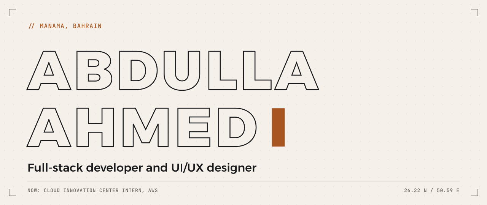
</picture>

  I design interfaces and build the systems behind them. Currently a Cloud Innovation Center intern at AWS, building an Arabic-first compliance tool. Studying ICT (Programming) at Bahrain Polytechnic and full-stack development at Reboot01.

  <a href="mailto:abdullamohd.ahmed@gmail.com">Email</a> &nbsp;·&nbsp;
  <a href="https://linkedin.com/in/abdulla-mohammed-shams">LinkedIn</a> &nbsp;·&nbsp;
  <a href="https://showroom.reboot01.com">Showroom (live)</a>

<picture>
  <source media="(prefers-color-scheme: dark)" srcset="./assets/section-01-dark.svg">
  <source media="(prefers-color-scheme: light)" srcset="./assets/section-01-light.svg">
  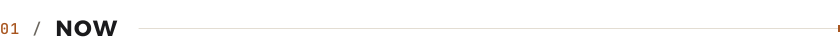
</picture>

<picture>
  <source media="(prefers-color-scheme: dark)" srcset="./assets/card-aws-dark.svg">
  <source media="(prefers-color-scheme: light)" srcset="./assets/card-aws-light.svg">
  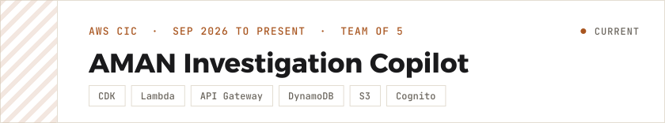
</picture>

Arabic-first AML screening tool for a financial compliance client, mentored by AWS Professional Services. Serverless on CDK, Lambda, API Gateway, DynamoDB, S3 and Cognito; I lead the bilingual RTL/LTR, light/dark design system.

<picture>
  <source media="(prefers-color-scheme: dark)" srcset="./assets/section-02-dark.svg">
  <source media="(prefers-color-scheme: light)" srcset="./assets/section-02-light.svg">
  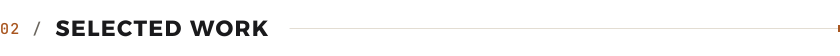
</picture>

<a href="https://showroom.reboot01.com">
<picture>
  <source media="(prefers-color-scheme: dark)" srcset="./assets/card-showroom-dark.svg">
  <source media="(prefers-color-scheme: light)" srcset="./assets/card-showroom-light.svg">
  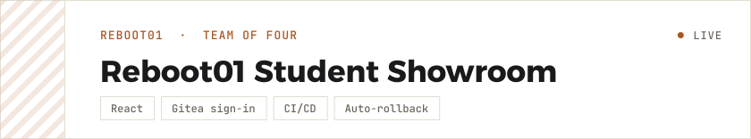
</picture>
</a>

Reboot01's official platform showing student work to prospective students and hiring partners. I designed every page and built the React frontend, Gitea sign-in and a tested, auto-rollback CI/CD pipeline, with a team of four. [showroom.reboot01.com](https://showroom.reboot01.com)

<a href="https://showroom.reboot01.com">
<picture>
  <source media="(prefers-color-scheme: dark)" srcset="./assets/shot-showroom-dark.png">
  <source media="(prefers-color-scheme: light)" srcset="./assets/shot-showroom-light.png">
  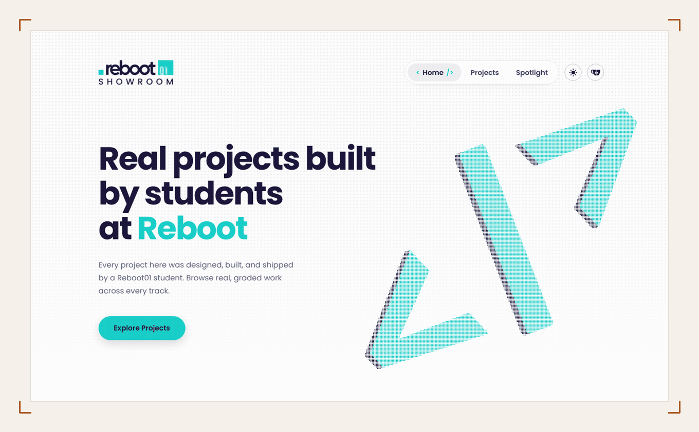
</picture>
</a>

 
 

<picture>
  <source media="(prefers-color-scheme: dark)" srcset="./assets/card-guidely-dark.svg">
  <source media="(prefers-color-scheme: light)" srcset="./assets/card-guidely-light.svg">
  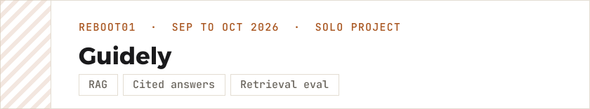
</picture>

Solo RAG assistant that answers from company documents with cited sources. 100% top-1 retrieval on a 20-question set across 3 runs, median response 1.0 to 1.3 s.

<picture>
  <source media="(prefers-color-scheme: dark)" srcset="./assets/shot-guidely-dark.png">
  <source media="(prefers-color-scheme: light)" srcset="./assets/shot-guidely-light.png">
  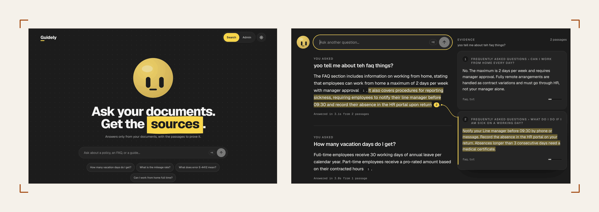
</picture>

 
 

<picture>
  <source media="(prefers-color-scheme: dark)" srcset="./assets/card-taalam-dark.svg">
  <source media="(prefers-color-scheme: light)" srcset="./assets/card-taalam-light.svg">
  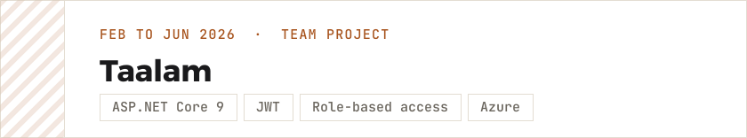
</picture>

Team training and certification platform on ASP.NET Core 9. I owned auth and role-based access (Admin, Trainer, Trainee) and the reporting app, deployed to Azure.

 
 

**Also built**

- **Bomberman**: multiplayer browser game on my own JavaScript framework, with WebSockets and n8n + OpenAI selfie sprites.
- [**Social Network Platform**](https://github.com/AbdullaMshams/husaiali-social-network): Go, React, SQLite and Docker, with groups, real-time chat and notifications.
- [**CTRL+ESC**](https://github.com/AbdullaMshams/CTRL-ESC): 3D escape-room game in Unity; I managed GitHub and merges.
- [**mini-framework**](https://github.com/AbdullaMshams/mini-framework): a JavaScript framework built from scratch, with TodoMVC.

<picture>
  <source media="(prefers-color-scheme: dark)" srcset="./assets/section-03-dark.svg">
  <source media="(prefers-color-scheme: light)" srcset="./assets/section-03-light.svg">
  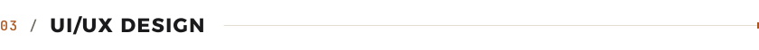
</picture>

<picture>
  <source media="(prefers-color-scheme: dark)" srcset="./assets/design-showcase-dark.png">
  <source media="(prefers-color-scheme: light)" srcset="./assets/design-showcase-light.png">
  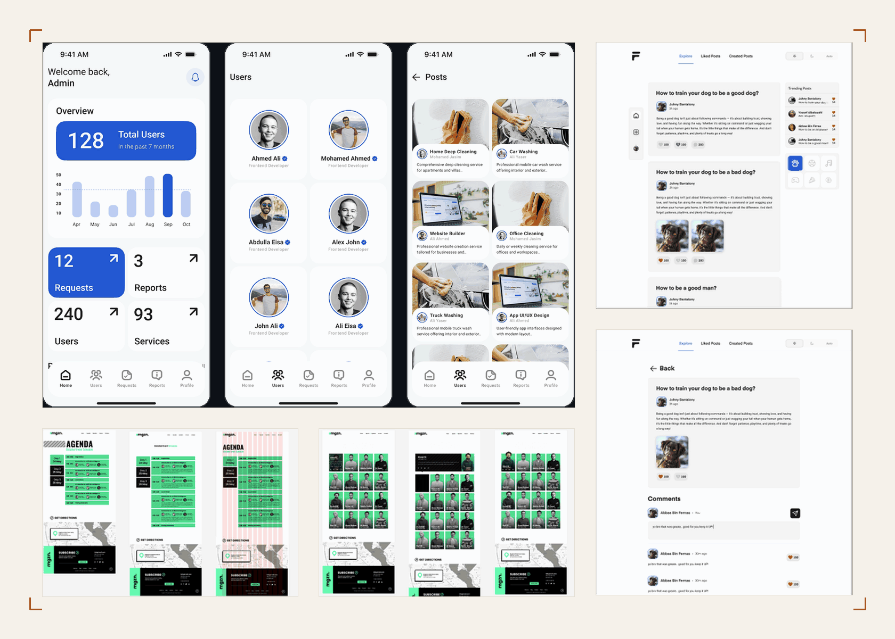
</picture>

Dubrah admin dashboard (Swift) · mgzn conference landing page (Figma) · Real-Time Forum (Figma, Go, JavaScript)

More design work

 

**mgzn.**: a multi-page landing site (About, Speakers, Agenda, Tickets) for a fictional tech conference. Figma, personal practice project, November 2023.

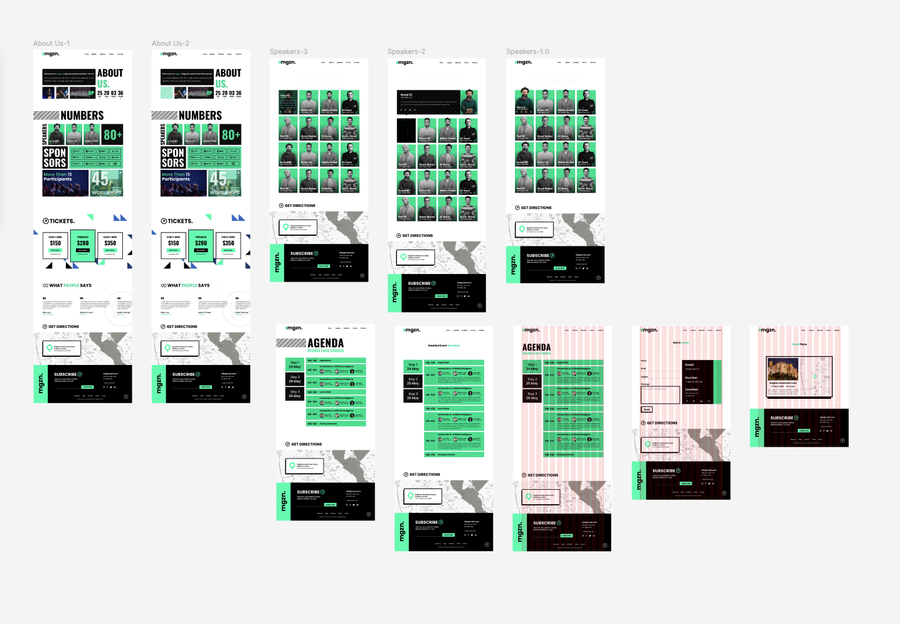

**Dubrah, full project board**: the whole app flow, not just the admin dashboard.

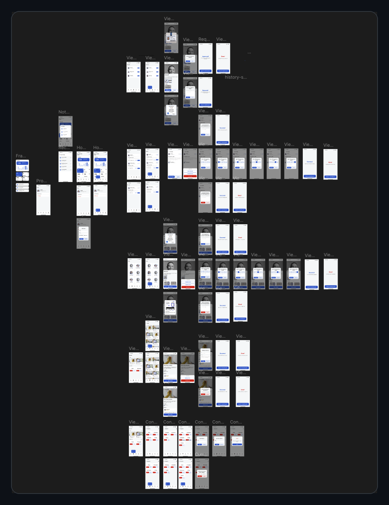

<picture>
  <source media="(prefers-color-scheme: dark)" srcset="./assets/section-04-dark.svg">
  <source media="(prefers-color-scheme: light)" srcset="./assets/section-04-light.svg">
  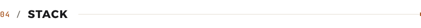
</picture>

<picture>
  <source media="(prefers-color-scheme: dark)" srcset="./assets/stack-dark.svg">
  <source media="(prefers-color-scheme: light)" srcset="./assets/stack-light.svg">
  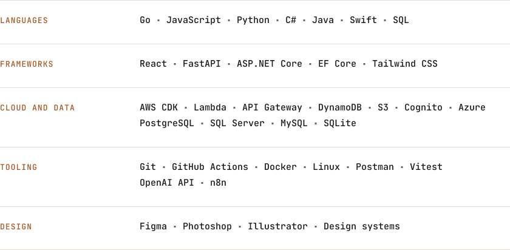
</picture>

<picture>
  <source media="(prefers-color-scheme: dark)" srcset="./assets/footer-dark.svg">
  <source media="(prefers-color-scheme: light)" srcset="./assets/footer-light.svg">
  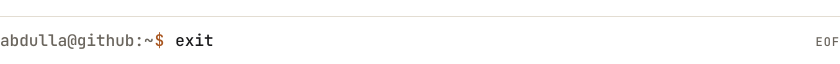
</picture>

  Bachelor of ICT (Programming), Bahrain Polytechnic, 2023 to expected 2027 
  Full Stack Development Diploma, Reboot Coding Institute, 2024 to expected 2027 
  NASA Space Apps Challenge 2024, Galactic Problem Solver 
  <a href="mailto:abdullamohd.ahmed@gmail.com">abdullamohd.ahmed@gmail.com</a>

